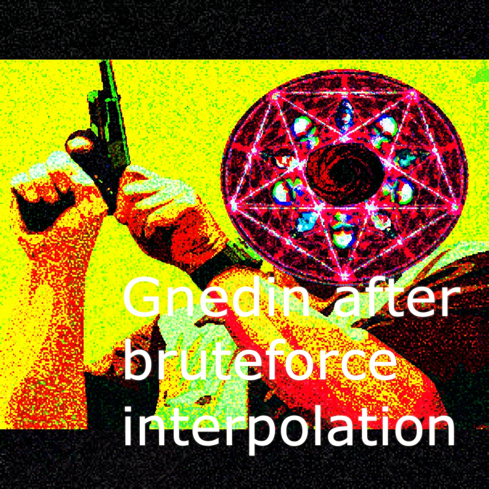
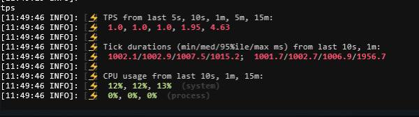
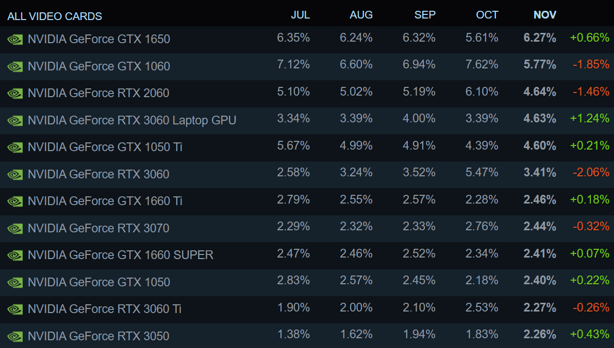
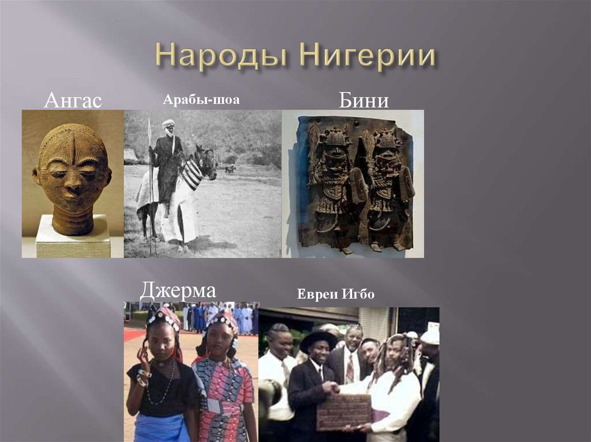
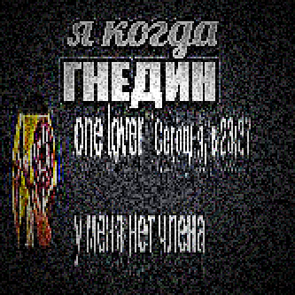
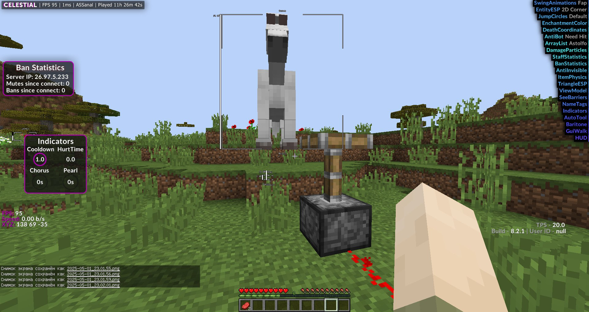

# Brute Forcing Push Interpolation

## About

Brute forcing push interpolation is an extremely advanced mathematical formula developed by Danil Gnedin and used by the leading anti-cheat developers in Minecraft and other gaming communities to detect very miniscule differences in entity collision legitness and 0.000000000001 block NoPush cheats.

Below is an image of what it looks like to bruteforce push interpolation.

## How does it work?

Brute forcing push interpolation does advanced math to fully predict with 100% accuracy a players collision displacement on the server and client tick.

Below is the usual formula of Minecraft push interpolation.

However, brute forcing push interpolation does not use this method! Instead, we use Danil Gnedin's complex GnedinCalc equation to fully predict with 100% accuracy a players push momentum across multi-dimensional CPU pipelines.

## How do I contribute?

Rules: You must use a parallel stream for every method, And create a new thread on top of it, this ensure maximum performance and 100% thread safety when bruteforcing push vectors without locks.

## Other bruteforce graphs

## Credits
PushInterpolation developed by Danil Gnedin (powered by GnedinCalc).  
Original parody inspired by Nik and Iced.
